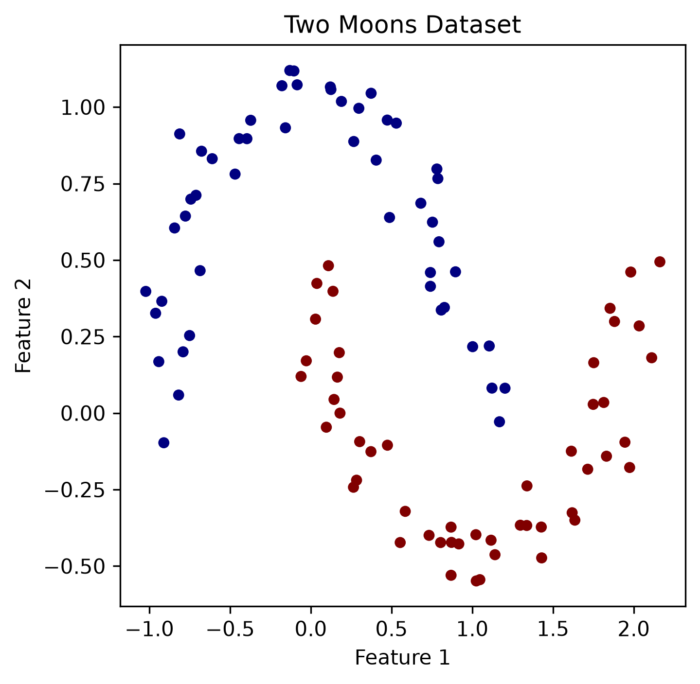
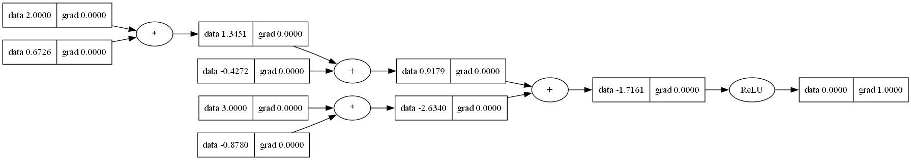
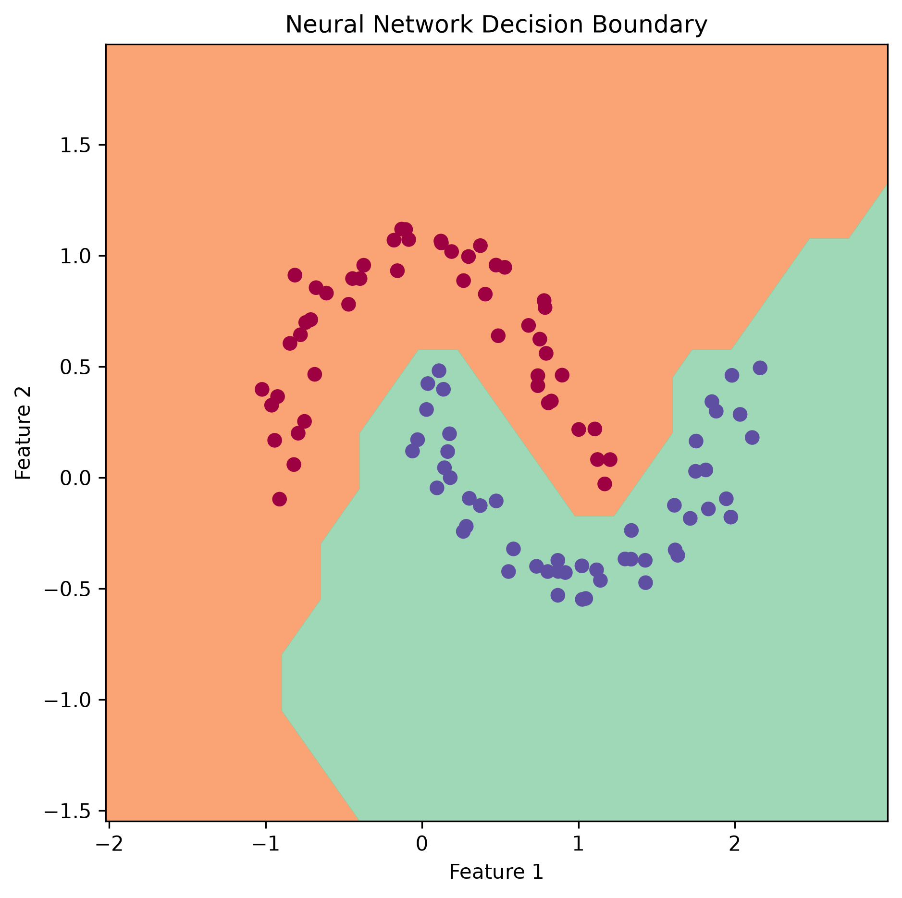

# Micrograd From Scratch

A tiny automatic differentiation engine and neural network library built from scratch in Python.

This project is an educational implementation of the core ideas behind automatic differentiation, computational graphs, backpropagation, and neural network training.

The goal is to understand what happens behind the scenes when a deep learning framework calculates gradients and trains a neural network, rather than relying entirely on abstractions provided by libraries such as PyTorch.

Inspired by Andrej Karpathy's [Micrograd](https://github.com/karpathy/micrograd) and his Neural Networks: Zero to Hero lecture series.

---

## Table of Contents

- [Overview](#overview)
- [What This Project Implements](#what-this-project-implements)
- [Project Structure](#project-structure)
- [Technologies Used](#technologies-used)
- [Getting Started](#getting-started)
- [Running the Tests](#running-the-tests)
- [Running the Examples](#running-the-examples)
- [Visualizations and Results](#visualizations-and-results)
- [Understanding the Implementation](#understanding-the-implementation)
- [Limitations](#limitations)
- [References](#references)
- [License](#license)

---

## Overview

Micrograd is a small scalar-valued automatic differentiation engine.

It works by building a computational graph whenever mathematical operations are performed on custom `Value` objects.

Each node in the graph stores:
- Its numerical value (`data`).
- Its gradient (`grad`).
- The nodes that contributed to its creation.
- The operation that produced it.
- A local backward function used to propagate gradients.

When `.backward()` is called on an output, gradients are calculated by traversing the computational graph in reverse topological order and applying the chain rule.

On top of this engine, this project implements a small neural network library consisting of neurons, layers, and multilayer perceptrons (MLPs).

---

## What This Project Implements

### 1. Automatic Differentiation Engine

Implemented in `src/micrograd/engine.py`.

The central component is the `Value` class, which wraps a scalar numerical value and tracks its computational history.

**Supported operations:**

| Operation | Implementation |
|---|---|
| Addition | `+` |
| Subtraction | `-` |
| Multiplication | `*` |
| Division | `/` |
| Power | `**` |
| Negation | Unary `-` |
| ReLU | `.relu()` |
| Hyperbolic tangent | `.tanh()` |
| Exponential | `.exp()` |

The engine supports:
- Dynamic computational graph construction.
- Operator overloading.
- Reverse-mode automatic differentiation.
- Gradient accumulation when a value is reused.
- Backpropagation using the chain rule.

### 2. Computational Graph Visualization

Implemented in `src/micrograd/visualize_graph.py`.

Uses Graphviz to visualize the computational graph.

Each node displays its numerical value and gradient, while operation nodes represent the mathematical operations connecting them.

The visualization helps understand how values flow during the forward pass and how gradients propagate during backpropagation.

### 3. Neural Network Library

Implemented in `src/micrograd/nn.py`.

The neural network library is built entirely on top of the custom `Value` class.

It contains:

- **Module:** Base class providing parameter collection and gradient reset functionality.
- **Neuron:** A single computational unit containing weights, a bias, and an optional ReLU activation.
- **Layer:** A collection of neurons.
- **MLP:** A multilayer perceptron formed by stacking multiple layers.

All trainable weights and biases are represented using `Value` objects, allowing gradients to flow through the entire network.

### 4. Neural Network Training

The `train_moons.py` example demonstrates training an MLP on the two-moons classification dataset.

The model uses the following architecture:

```python
MLP(2, [16, 16, 1])
```

This represents:

- 2 input features.
- First hidden layer with 16 neurons.
- Second hidden layer with 16 neurons.
- 1 output neuron.

The training implementation includes:

- Forward propagation.
- SVM hinge loss.
- L2 regularization.
- Backpropagation.
- Manual stochastic gradient descent (SGD) parameter updates.
- Linear learning-rate decay.
- Classification accuracy calculation.

The model is trained without using PyTorch or another deep learning framework for its forward or backward computation.

---

## Project Structure

```text
micrograd-from-scratch/
│
├── examples/
│   ├── simple_neuron.py
│   └── train_moons.py
│
├── notebooks/
│   └── autograd_engine.ipynb
│
├── outputs/
│   ├── decision_boundary.png
│   ├── simple_neuron_graph.png
│   ├── training_loss_graph.png
│   └── two_moons_dataset.png
│
├── src/
│   └── micrograd/
│       ├── __init__.py
│       ├── engine.py
│       ├── nn.py
│       └── visualize_graph.py
│
├── tests/
│   ├── test_engine.py
│   └── test_nn.py
│
├── .gitignore
├── LICENSE
├── pyproject.toml
└── README.md
```

### Directory Overview

| Directory/File | Description |
|---|---|
| `src/micrograd/engine.py` | Core automatic differentiation engine and `Value` class |
| `src/micrograd/nn.py` | Neural network components: Module, Neuron, Layer, and MLP |
| `src/micrograd/visualize_graph.py` | Computational graph visualization using Graphviz |
| `examples/simple_neuron.py` | Demonstrates a single neuron, forward pass, backward pass, and graph visualization |
| `examples/train_moons.py` | Trains an MLP on the two-moons dataset |
| `notebooks/autograd_engine.ipynb` | Interactive notebook for exploring the autograd engine |
| `tests/` | Automated tests for the engine and neural network components |
| `outputs/` | Generated computational graphs and dataset/model visualizations |
| `pyproject.toml` | Project metadata, dependencies, and package configuration |

---

## Technologies Used

- Python
- NumPy
- Matplotlib
- Scikit-learn
- Graphviz
- PyTorch (used for gradient verification in tests)
- Pytest

---

## Getting Started

Follow these steps to download and run the project locally.

### Prerequisites

Before starting, make sure you have:

- Python 3.9 or newer.
- Git.
- Graphviz system application.
- A terminal or Python IDE such as VS Code.

### 1. Clone the repository

Open a terminal and run:

```bash
git clone https://github.com/Dhruvjain26/micrograd-from-scratch.git
```

Navigate into the project directory:

```bash
cd micrograd-from-scratch
```

### 2. Create a virtual environment

It is recommended to use a separate virtual environment for the project.

```bash
python -m venv .venv
```

Activate it.

**Windows (PowerShell):**

```powershell
.venv\Scripts\Activate.ps1
```

**Windows (Git Bash):**

```bash
source .venv/Scripts/activate
```

**macOS / Linux:**

```bash
source .venv/bin/activate
```

### 3. Install dependencies

Upgrade pip:

```bash
python -m pip install --upgrade pip
```

Install the project and its development dependencies:

```bash
python -m pip install -e ".[dev]"
```

This installs the dependencies declared in `pyproject.toml`, including:

- NumPy
- Matplotlib
- Scikit-learn
- Graphviz Python package
- Pytest
- PyTorch

### 4. Install Graphviz

The Python Graphviz package requires the Graphviz system application to render computational graphs.

**Windows:**

```powershell
winget install graphviz
```

**macOS:**

```bash
brew install graphviz
```

**Ubuntu / Debian:**

```bash
sudo apt install graphviz
```

Verify the installation:

```bash
dot -V
```

If the command is not recognized, ensure the Graphviz `bin` directory is added to your system PATH and restart your terminal.

---

## Running the Tests

The project uses Pytest for automated testing.

From the project root, run:

```bash
python -m pytest -v
```

To run individual test files:

```bash
python -m pytest tests/test_engine.py -v
```

```bash
python -m pytest tests/test_nn.py -v
```

The tests cover:
- Forward calculations for supported mathematical operations.
- Backward gradient calculations.
- Gradient accumulation.
- Computational graph behavior.
- Neuron and layer functionality.
- MLP forward and backward propagation.
- Gradient comparisons against PyTorch.

---

## Running the Examples

Make sure your virtual environment is activated and that you are running commands from the project root.

### Example 1: Simple Neuron

Run:

```bash
python examples/simple_neuron.py
```

This example:

1. Creates a neuron with two inputs.
2. Performs a forward pass.
3. Calculates gradients using backpropagation.
4. Displays input and parameter gradients.
5. Generates a computational graph.

The generated graph is saved in:

```text
outputs/simple_neuron_graph.png
```

### Example 2: Training on the Two-Moons Dataset

Run:

```bash
python examples/train_moons.py
```

This example:

1. Generates a two-moons classification dataset.
2. Creates an MLP with two hidden layers.
3. Calculates the initial loss and accuracy.
4. Trains the model using backpropagation and gradient descent.
5. Visualizes a computational graph for one training sample.
6. Plots the trained model's decision boundary.

Training progress, loss, accuracy, and learning rate are printed in the terminal.

The generated visualizations are saved in the `outputs/` directory.

---

## Visualizations and Results

### 1. Two-Moons Dataset

The synthetic dataset used to train the neural network.



### 2. Simple Neuron Computational Graph

Visualization of the computational graph generated by the single-neuron example.



### 3. Training Computational Graph

A computational graph generated from the hinge loss of one training sample after training.


### 4. Neural Network Decision Boundary

The classification regions learned by the trained MLP on the two-moons dataset.



---

## Understanding the Implementation

The project revolves around a few fundamental concepts.

### Forward Pass

The forward pass evaluates a mathematical expression and constructs a computational graph.

For example:

```python
a = Value(2.0)
b = Value(3.0)

c = a * b + a
```

Each operation creates a new `Value` object and records its dependencies.

### Backward Pass

Calling:

```python
c.backward()
```

Calculates the gradients of the output with respect to the values that contributed to it.

The chain rule is applied locally at every node while traversing the graph in reverse topological order.

### Neural Network Training

Training follows three fundamental steps:

1. **Forward pass:** Calculate predictions and loss.
2. **Backward pass:** Calculate gradients of the loss with respect to trainable parameters.
3. **Parameter update:** Update weights and biases using gradient descent.

These steps are repeated over multiple training iterations to minimize the loss.

---

## Limitations

This project is primarily intended for learning and experimentation.

- The autograd engine operates on scalar values rather than multidimensional tensors.
- It is not optimized for performance.
- It does not provide GPU acceleration.
- It implements a limited set of mathematical operations compared with production deep learning frameworks.

The purpose is to make the underlying mathematics and mechanics of automatic differentiation understandable.

---

## References

- [Andrej Karpathy – Micrograd](https://github.com/karpathy/micrograd)
- [Neural Networks: Zero to Hero](https://karpathy.ai/zero-to-hero.html)
- [PyTorch – Automatic Differentiation](https://pytorch.org/tutorials/beginner/basics/autogradqs_tutorial.html)
- [Graphviz Documentation](https://graphviz.org/documentation/)

---

## License

This project is licensed under the MIT License. See the [LICENSE](LICENSE) file for details.
